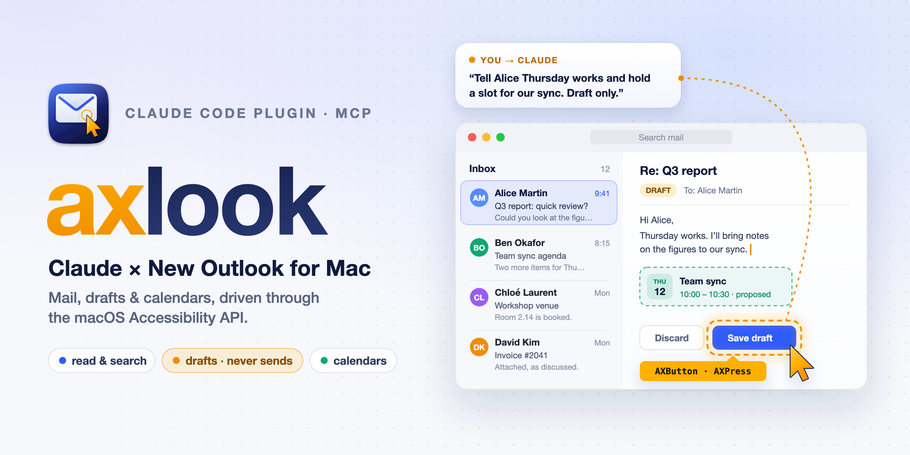
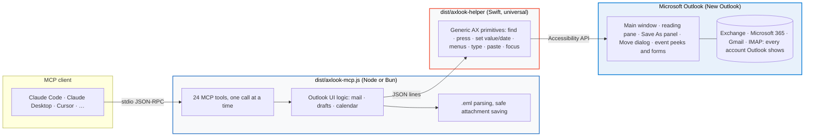

<div align="center">


# axlook-mcp

### Let Claude work with New Outlook for Mac: mail, drafts and calendars, without Graph, tokens or app registrations

[](#-install)
[](https://modelcontextprotocol.io)
[]()
[]()
[](#-tools)
[](#-safety-by-design)
[](LICENSE)

<br/>



<br/>

**axlook** (**A**ccessibility + Out**look**) is a local MCP server that drives the Outlook app you already have open, through the macOS Accessibility API. It sees every account Outlook shows, including Exchange and Microsoft 365 mailboxes whose organization only allows the Outlook app.

```text
/plugin install axlook-mcp --marketplace flol3622/axlook-mcp
```

</div>

<br/>

---

## 🌟 At a Glance

New Outlook for Mac hides cloud accounts from AppleScript: its scripting dictionary sees **zero** Exchange accounts and an empty Inbox. Microsoft has cancelled its plan to bring AppleScript back. Here is how the usual options compare:

| | AppleScript / JXA servers | Microsoft Graph servers | Local cache readers | **axlook** |
| :--- | :---: | :---: | :---: | :---: |
| **Works with New Outlook** | ❌ Legacy Outlook only | ✅ | ✅ | ✅ |
| **Needs app registration or tokens** | No | ❌ Tenant consent, OAuth | No | ✅ **No, uses Outlook's own sign-in** |
| **Works where only the Outlook app is allowed** | ✅ | ❌ Usually blocked | ✅ | ✅ **Yes, it *is* Outlook** |
| **Read mail and full source** | ✅ | ✅ | ⚠️ Sync window only | ✅ |
| **Attachments** | ✅ | ✅ | ❌ | ✅ |
| **Move, flag, read/unread** | ✅ | ✅ | ❌ Read-only | ✅ |
| **Calendar create/edit/delete** | ✅ | ✅ | ❌ | ✅ |
| **Permission needed** | Automation | Cloud consent | ❌ Full Disk Access | ✅ **Accessibility** |
| **Can send mail by accident** | Possible | Possible | No | ✅ **Never: drafts only** |

---

## 📦 Install

**You need:**
- macOS 13 or later
- **New Outlook for Mac** running, with its language set to English
- **Node.js 18+** or **Bun** (Claude Code users nearly always have one of them)

### Claude Code (recommended)

On Claude Code 2.1.275 or later, one command:

```text
/plugin install axlook-mcp --marketplace flol3622/axlook-mcp
```

On older versions, or to browse the marketplace first:

```text
/plugin marketplace add flol3622/axlook-mcp
/plugin install axlook-mcp@axlook
```

The plugin bundles:
- **the MCP server**, a prebuilt universal helper and a single-file server, so there's nothing to compile or `npm install`;
- **two skills**: `outlook` tells Claude to use these tools for every mail and calendar question, and `conventions` sets up your personal rules (see [Personal conventions](#-personal-conventions)).

Update with `/plugin update axlook-mcp`. Third-party marketplaces don't auto-update.

### Grant Accessibility (once)

macOS gives the permission to the app that runs Claude, not to axlook itself:

1. Open *System Settings → Privacy & Security → Accessibility*.
2. Enable the app that runs Claude: **Terminal**, **iTerm**, **Visual Studio Code**, **Cursor** or **Claude**.
3. **Restart that app.**
4. Ask Claude to run `outlook_status`. It reports `trusted: true` once permission is in place.

> Accessibility lets that app control others. Grant it only to apps you trust, and remove it if you stop using axlook.

### Other MCP clients (Claude Desktop, Cursor, VS Code, …)

Clone the repository, then point your client at the bundled launcher:

```bash
git clone https://github.com/flol3622/axlook-mcp ~/axlook-mcp
```

```json
{
  "mcpServers": {
    "axlook": { "command": "/bin/sh", "args": ["/Users/YOU/axlook-mcp/scripts/start.sh"] }
  }
}
```

If the package is published on npm, `npx` works too, with no clone needed:

```bash
claude mcp add axlook -s user -- npx -y axlook-mcp
```

---

## 🏛️ Architecture



- **The Swift helper is generic.** It knows nothing about Outlook, only the Accessibility API. All Outlook-specific knowledge lives in TypeScript (`src/outlook/`), where it is easy to adjust when Outlook's UI changes.
- **No network access of its own.** axlook never talks to Exchange, Google or any other service; Outlook does.

---

## 🧰 Tools

👻 = runs in the background (Outlook can stay behind your windows, even on another Space).
🪟 = briefly brings Outlook to the front for menus, dialogs or typing, then returns focus.
📄 = local file only, no Outlook access.

| Area | Tool | Mode | What it does |
| :--- | :--- | :---: | :--- |
| **Diagnostics** | `outlook_status` | 👻 | Outlook running? Accessibility granted? Screen locked? |
| | `outlook_ui_snapshot` | 👻 | Dumps part of Outlook's accessibility tree, for debugging UI changes |
| **Mail** | `outlook_list_folders` | 👻 | Folders of every account as `account/Parent/Child`, with unread and total counts |
| | `outlook_list_messages` | 👻 | Sender, subject, date, preview, unread / flagged / replied / attachment / meeting markers |
| | `outlook_search_messages` | 👻 | Outlook's own search (`from:`, `subject:`, `hasattachments:yes`…), per mailbox or across all accounts |
| | `outlook_read_message` | 👻 | Headers, body text and links; leaves the message unread unless asked |
| | `outlook_get_message_source` | 🪟 | Full RFC 822 source: Message-ID, all addresses, text and HTML, attachment list |
| | `outlook_save_attachments` | 🪟 | Writes attachments to a folder (sanitized names, never overwrites) |
| | `outlook_move_message` | 🪟 | Moves to any folder of any account and checks the move happened |
| | `outlook_mark_read` · `outlook_set_flag` | 🪟 | Read/unread, flag/clear flag |
| | `outlook_archive_message` · `outlook_delete_message` | 🪟 | Archive; delete moves to Deleted Items (drafts are discarded) |
| **Drafts** | `outlook_create_draft` | 🪟 | To/Cc/Bcc, subject, text or HTML body, choice of From account |
| | `outlook_create_reply_draft` · `outlook_create_forward_draft` | 🪟 | Your text above the quoted original. **Saved, never sent** |
| **Calendar** | `outlook_list_calendars` | 👻 | Calendars of every account, and whether each is shown |
| | `outlook_list_events` | 👻 | Time, location, recurrence, organizer, your response, attendees |
| | `outlook_get_event` | 👻 / 🪟 | One event; `full=true` adds the calendar name, attendee list and description |
| | `outlook_create_event` · `outlook_update_event` · `outlook_delete_event` | 🪟 | Appointments in any calendar, using local wall-clock times |
| **Conventions** | `outlook_get_conventions` · `outlook_set_conventions` | 📄 | Read and save your personal rules (no Outlook access) |

List and search calls return **refs** (`msg_…`, `evt_…`) that the other tools take as input. Outlook's UI exposes no stable IDs, so a ref encodes where the item is shown and what it looks like. If a ref goes stale, list again.

---

## 🚀 Quickstart

Once installed, just ask:

> *"What's unread in my work inbox? Summarize anything about the conference."*
>
> *"Save the PDFs from the latest mail from Alice to ~/Downloads/Reviews."*
>
> *"Move this week's registration notifications into the Conference/Registrations folder."*
>
> *"Draft a reply to Bob confirming Thursday. Don't send it."*
>
> *"Block Friday 10:00–11:30 in my Personal calendar for 'Paper revision'."*

---

## 🧭 Personal Conventions

Everyone organizes mail and calendars differently, so axlook keeps **your rules** in one small Markdown file, `~/.config/axlook/conventions.md`. It lives outside the plugin, so it survives updates. Ask Claude:

> *"Set up my axlook conventions."*

The `conventions` skill reads your real calendars and accounts, asks a few questions, shows you the file, and saves it only once you approve. Later, *"from now on, put social events in Family"* updates a single rule. You can also edit the file by hand:

```markdown
---
default_calendar: you@work.example/My Calendars/Calendar
default_from: you@work.example
---
# Calendars
- Work and professional → `you@work.example/My Calendars/Calendar`
- Personal, for me only → `you@work.example/My Calendars/Personal`
- Social, with my partner → `you@gmail.example/Family`

# Sending
- Work mail from `you@work.example`; private mail from `you@gmail.example`.
```

- **Rules are guidance.** The server shows the file to Claude at startup, and `outlook_get_conventions` returns the current version. Claude follows the rules when picking calendars, accounts and folders.
- **Defaults are enforced.** In the front matter, `default_calendar` applies to new events and `default_from` to new drafts, whenever a call leaves them out. Outlook's "last used calendar" never decides. Each result tells you whether the value came from your argument, from your conventions, or from Outlook. Replies and forwards always use the account that received the original message. Any other front-matter key is guidance for Claude only.
- **Moving the file:** set `AXLOOK_CONFIG_DIR`. The previous version is always kept as `conventions.md.bak`.

---

## 🛡️ Safety by Design

- **Nothing is ever sent.** Drafts, replies and forwards land in Drafts for you to review. Meetings that would notify attendees are refused.
- **Nothing is permanently deleted.** Delete moves to Deleted Items, and deleting from a deleted-items folder is refused.
- **Your typing wins.** If you're writing a draft in Outlook, tools refuse to navigate away from it.
- **Keystrokes can't go astray.** Keys are delivered only to Outlook's process, and only while it is frontmost. Shortcuts use menu commands rather than key codes, so any keyboard layout works (AZERTY included).
- **Your clipboard is restored.** Pasted bodies borrow it briefly, mark the paste transient for clipboard managers, and put your clipboard back afterwards.
- **Threads are handled one message at a time.** Tools never act on a whole conversation row. They expand it and act on the specific message.
- **Data stays local.** Nothing leaves your Mac except through Outlook itself.

---

## 🔬 How It Works

1. **Reading across Spaces.** `AXWindows` returns nothing when Outlook is on another Space or in full screen, but `AXMainWindow` still reaches it. Reading never needs Outlook in front.
2. **Full source through Save As.** Outlook is sandboxed, so axlook saves the message as `.eml` into `~/Downloads` under a unique name, waits for the write to finish, moves the file into a private temp folder and parses it. That gives Message-ID, HTML and attachments without clicking through the UI.
3. **Calendar through event peeks.** Each event tile has a hidden "Show event" action. It opens a preview in the background with stable fields for subject, date, time, location, recurrence, organizer and body, plus Edit and Delete buttons.
4. **Typing reaches Outlook's data.** Writing a field's value only changes what's displayed. Subjects and descriptions are typed as keystrokes into Outlook, then read back to confirm.

---

## ⚠️ Limitations

- **English UI only.** Labels such as "Message List" and the menu titles are matched; localization is future work.
- **Speed.** Calls take 2–15 seconds, since this is UI automation. Search waits for Outlook's server-side results.
- **Read-only meetings.** Meetings with attendees can't be created or edited, because that would send mail.
- **Recurring events.** Edits and deletes apply to the selected occurrence.
- **Shared screen.** 🪟 tools take Outlook's window for a few seconds. If you switch apps mid-action, axlook re-activates Outlook once, then fails cleanly.
- **Locked screen.** Nothing works while the Mac is locked.

---

## 📊 Verification

The Accessibility selectors were mapped on Outlook 16.114 / macOS 27, against a profile with Exchange, two shared mailboxes and Gmail. `scripts/e2e.ts` drives every tool through the MCP protocol against the live app.

| Area | Live-tested |
| :--- | :--- |
| Mail | folders, list, search, read, `.eml` source, attachments (byte-exact PDF), read/unread, flag, move and back |
| Drafts | new, reply and forward; discarding drafts |
| Calendar | list calendars and events; create → get → edit → delete |
| Not yet | archive and delete on regular messages (the code paths are shared with move and draft discard) |

```bash
bun test   # offline: row parser, calendar dates, MIME and attachments
E2E_FOLDER=… E2E_MOVE_TO=… E2E_SELF=… E2E_ATTACH_SCOPE=… E2E_CALENDAR=… bun scripts/e2e.ts
```

The e2e variables are documented in the header of `scripts/e2e.ts`.

---

## 🛠️ Development

```text
.claude-plugin/        plugin.json (incl. the MCP server entry) + marketplace.json (the repo is its own marketplace)
skills/outlook/        skill shipped with the plugin
scripts/start.sh       launcher: picks Node/Bun, checks the helper (rebuilds it from source if needed)
dist/                  shipped build: axlook-mcp.js (bundle) + axlook-helper (universal, ad-hoc signed)
helper/OutlookAX.swift Accessibility bridge (JSON lines over stdio)
src/                   MCP server (TypeScript): ax.ts, outlook/{session,mail,compose,calendar}.ts, mime.ts
test/                  bun test suites
```

```bash
bun install
bun run build        # dist/axlook-helper (arm64 + x86_64) and dist/axlook-mcp.js
bun test && bun run typecheck
claude plugin validate . --strict
```

`dist/` is committed because the plugin runs it as is. Rebuild and commit it together with any change to `src/` or `helper/`. To release, bump `version` in both `package.json` and `.claude-plugin/plugin.json`.

To inspect Outlook's UI when it changes, use `outlook_ui_snapshot`, or query the helper directly:

```bash
printf '%s\n' '{"id":1,"cmd":"tree","h":"main","depth":3}' | dist/axlook-helper
```

---

## 📖 Acknowledgements

- [trsdn/outlook-ax](https://github.com/trsdn/outlook-ax) (MIT): its map of New Outlook's accessibility paths was a valuable starting point.
- [postal-mime](https://github.com/postalsys/postal-mime) for MIME parsing, and the official [MCP TypeScript SDK](https://github.com/modelcontextprotocol/typescript-sdk).
- Built with [Claude Code](https://claude.com/claude-code).

---

<div align="center">
  <b>MIT License</b> · Not affiliated with Microsoft. Outlook is a trademark of Microsoft Corporation.
</div>
